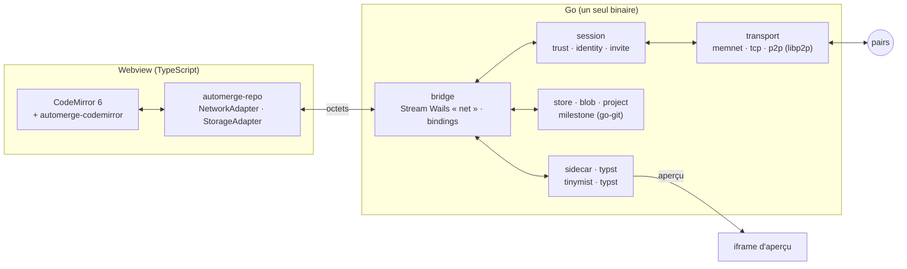

# Architecture

> Source : [document de conception](conception.pdf) (24 oct. 2026). Ce fichier en est la
> projection technique ; les décisions et leur raison sont dans [`adr/`](adr/).

## En une phrase

Un éditeur de bureau où plusieurs personnes écrivent en direct un même projet Typst,
Markdown ou texte, **sans serveur**. Le CRDT vit dans la webview ; Go ne transporte que des
octets opaques, gère le réseau, le disque et les processus annexes.

## Les quatre couches

| Couche | Rôle | Ce qu'elle ne fait **pas** |
|---|---|---|
| Webview | Édition, fusion Automerge, curseurs, undo par auteur, UI Adwaita | Aucun accès disque ni réseau direct |
| Pont | Transport d'octets opaques dans les deux sens | Ne décode jamais un document |
| Session | Identité, invitations, liste de membres signée, relais des updates | Ne connaît pas le format Automerge au-delà des signatures |
| Stockage / Typst | Persistance, blobs, projection `.typ`, jalons, sidecars | Ne décide rien de la fusion |

## Paquets Go (cible)

Un paquet = un rôle. Chaque paquet est créé **à l'étape qui en a besoin**, pas avant ; la
colonne « Étape » dit quand.

| Paquet | Responsabilité | Étape |
|---|---|---|
| `cmd/inkwell` | Point d'entrée : fenêtre Wails ; plus tard sous-commandes sans fenêtre (`export`, `join`) | 1 |
| `internal/app` | Services Wails liés au frontend (`Session` : identité, inviter, rejoindre) ; la composition vit dans `cmd/inkwell` | 1 |
| `internal/bridge` | Routeur Stream Wails `net` ↔ `Transport` (octets opaques, aucun port local — ADR 0009) | 1 |
| `internal/transport` | Interface `Transport` (`Send`, `Recv`, `Peers`) ; `memnet` (simulation), `tcp` (étape 1), `p2p` (libp2p, étape 2) | 1 |
| `internal/identity` | Clé Ed25519 par machine, empreinte prononçable (4 mots), groupes d'appareils | 2 |
| `internal/invite` | Codes Wormhole (PAKE), acceptation d'un pair LAN | 2 |
| `internal/trust` | Liste de membres signée (CRDT à ordre total Lamport → clé), rôles, révocation, vérification des lots signés | 2 |
| `internal/store` | État Automerge sur disque (écritures atomiques `renameio`), sauvegardes, contrôle d'intégrité | 2 |
| `internal/project` | Projet = dossier : index, règle de propriété fsnotify, bac à sable des E/S, corbeille | 2 |
| `internal/sidecar` | Binaires embarqués vérifiés SHA-256, supervision, backoff, arrêt avec le parent | 3 |
| `internal/typst` | Vente des paquets `@preview` dans `.typstdeps/`, polices, export PDF | 3 |
| `internal/blob` | Magasin adressé par BLAKE3, quotas, échange sur flux libp2p dédié | 4 |
| `internal/milestone` | Jalons go-git (projection lisible, jamais source de vérité) | 4 |
| `internal/transport/memnet` | Réseau en mémoire à fautes injectées, déterministe sous `testing/synctest` (ADR 0011) | 1 |
| `frontend/` | Svelte 5 + Vite + TypeScript : CodeMirror, automerge-repo, adaptateur réseau vers le pont, simulation de convergence (Vitest), CSS Adwaita (ADR 0010) | 1 |
| `build/` | Configuration Wails v3 (`config.yml`, Taskfiles par plateforme, icônes) | 1 |

### Règles de dépendance

- `transport` n'importe rien d'interne. `trust` et `identity` n'importent pas `transport`.
- `app` est le seul paquet qui connaît tous les autres ; aucun paquet n'importe `app`.
- Aucun code Go n'importe Automerge : la convergence se teste en TypeScript avec le vrai
  `automerge-repo` ; Go teste sa colle sur `transport/memnet` (ADR 0011).
- Tout ce qui lit des octets venus d'un pair est fuzzé (`go test -fuzz`).

## Trois cohérences (du document)

1. **Une seule source de vérité par chose** : le texte dans Automerge, les blobs dans le
   magasin par hachage, les membres dans la liste signée, les versions dans go-git comme
   projection. Aucun panneau n'invente sa propre vérité.
2. **Un seul vocabulaire** : voir [glossaire](glossary.md).
3. **Tout ce qui se voit se désactive** : présence, découverte LAN, relais, vignettes,
   correcteur, résumés ; le réglage est à côté de la fonction.

## Sécurité des frontières

- Pont webview ↔ Go : Streams Wails, **aucun port local** (ADR 0009). Seuls serveurs
  locaux restants (plan de données tinymist) : `127.0.0.1`, port éphémère, jeton aléatoire
  comparé en temps constant, jamais journalisé.
- Sidecars : hachage vérifié avant chaque lancement, `--root` sur le dossier projet,
  `context.WithTimeout`, relance bornée, mort avec le parent (job object sous Windows).
- Réseau : Noise de bout en bout, chaque lot d'updates signé par son auteur, refusé si
  l'auteur n'est pas membre en écriture.

## Plateformes et cgo

Wails v3 exige cgo sous Linux (GTK4 / WebKitGTK 6.0) et macOS. Chaque plateforme est donc construite
**nativement** dans une matrice GitHub Actions, sans cross-compilation — voir
[ADR 0003](adr/0003-wails-v3-cgo-native-builds.md).
